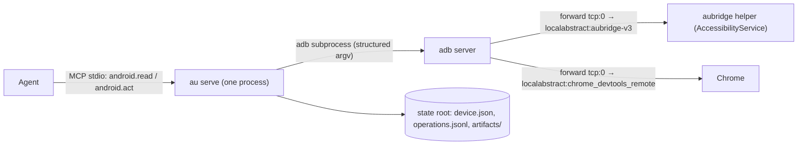
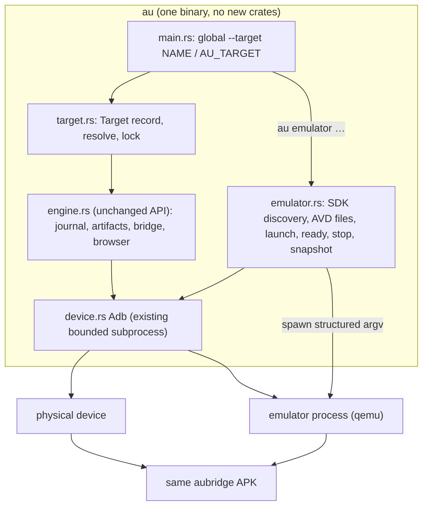
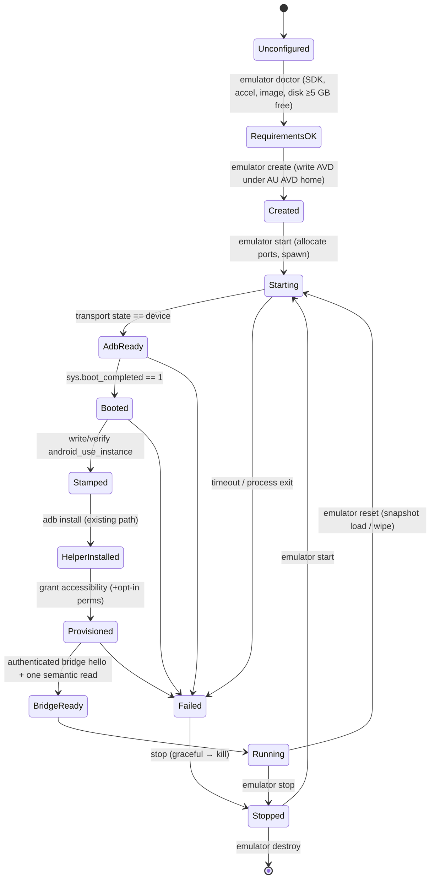

# Android emulator integration plan

Status: **planning, approved for nothing yet**. No production code has changed. This document sits alongside [redesign.md](redesign.md), and both feed the master [roadmap.md](roadmap.md).

Baseline: `main` at `5509535` (Android Use 1.0.0), reviewed on 2026-10-10. File and line references are to that commit.

## How to read this document

Each claim carries one of these status tags:

| Tag | Meaning |
| --- | --- |
| **[code]** | Read directly in the source at the cited line |
| **[doc]** | Confirmed against official Android, Google or AOSP documentation (URL given) |
| **[inferred]** | Reasoned from code or docs, not executed |
| **[validate]** | Must be proven on a real emulator before we depend on it |

No emulator was run while writing this plan. The planning container has no `/dev/kvm` and no Android SDK, so every runtime behaviour below is unexecuted until Phase 1 runs.

## Contents

- A. [Current architecture assessment](#a-current-architecture-assessment)
- B. [Emulator technology decision record](#b-emulator-technology-decision-record)
- C. [Unified architecture design](#c-unified-architecture-design)
- D. [Source-level change plan](#d-source-level-change-plan)
- E. [Security and isolation design](#e-security-and-isolation-design)
- F. [Resource and performance plan](#f-resource-and-performance-plan)
- G. [Phased implementation roadmap](#g-phased-implementation-roadmap)
- H. Master roadmap integration → [roadmap.md](roadmap.md)
- I. [Decision register](#i-decision-register)
- J. [Immediate engineering backlog](#j-immediate-engineering-backlog)
- K. [Test matrix and release gates](#k-test-matrix-and-release-gates)

---

## A. Current architecture assessment

### A.1 What exists today



- **One state root, one device.** The state root is chosen by `Paths::discover`: `AU_HOME`, then `%LOCALAPPDATA%\AndroidUse`, then `$XDG_STATE_HOME/android-use`, then `~/.local/state/android-use` (`device.rs:23-37`). It holds exactly `device.json`, `operations.jsonl` and `artifacts/` (`device.rs:38-43`). Nothing is keyed per device. [code]
- **Identity is the guest's `ro.serialno`.** The fallback is `ro.boot.serialno` (`device.rs:163-172`). `device.json` stores `{hardware, endpoint}` (`device.rs:51-55, 123-128`). [code]
- **Resolution scans every connected device.** `Adb::resolve` (`device.rs:129-150`) lists every adb device in `device` state and sorts endpoints with no `:` first. That group includes USB serials **and `emulator-5554`**. It then returns the **first** device whose serial matches, with no ambiguity check. Resolution runs on every `Engine::open` (`engine.rs:189`) and again on every connection reset mid-session (`engine.rs:219-223`). [code]
- **Enrollment** happens automatically when exactly one device is ready (`device.rs:151-162`). Otherwise `au enroll ENDPOINT` (`install.rs:132`) binds explicitly. [code]
- **One device per process, by design.** `docs/production.md:3` says "one locally enrolled device per server process", and `Engine` has no globals (`engine.rs:174-186`). Two engines in one process would still read the same `device.json` and the same journal. [code]
- **The journal has no cross-process lock.** It is loaded once (`engine.rs:55-72`), then compacted by atomically rewriting the file from this process's in-memory view (`engine.rs:127-140`). Two processes sharing a root therefore erase each other's records. [code]
- **Operation IDs repeat across sessions** (pre-existing bug).
  - `operation_id = sha256(kind ‖ JSON-RPC id)` (`engine.rs:659-667`), with the request identity taken from the JSON-RPC `id` (`adapter.rs:51`). The journal persists across processes, so a new MCP session that reuses `id: 3` collides with an old record.
  - The collision gives either an `Args` error (`engine.rs:159`) or, if digest and generation match, a **replayed receipt without execution** (`engine.rs:158`). [code, consequence inferred]
- **The journal digest only covers the serial and the plan.** It is `sha256(ro.serialno ‖ plan.wire)` (`engine.rs:742-745`). Two devices with the same serial produce the same digest. [code]
- **Setup** runs these steps (`install.rs:143-180`):
  1. install the APK with `adb install -r -d -t`;
  2. `am start-foreground-service`;
  3. check that the package is present;
  4. read `enabled_accessibility_services`;
  5. if that setting is off, open Accessibility settings and poll every 500 ms for 60 s while the user flips the toggle.

  It never writes settings, never checks `sys.boot_completed`, and never checks the transport type. "USB" appears only in wording (`install.rs:25, 35-46, 254`). [code]
- **Helper authentication.** The helper serves only peer uid 2000, i.e. adbd running as `shell` (`Bridge.java:38`).
  - A bootstrap socket hands out a token and nonce, which a hello on the command socket must return (`Bridge.java:35-39`).
  - The fixed worker pool has 2 workers and an 8-slot queue (`Bridge.java:31`).
  - **`adb root` breaks the bridge**, because adbd then runs as uid 0. [code]
- **Forwards** use dynamic `tcp:0` ports and an allowlist of three abstract sockets (`device.rs:208-214`). They are removed in `Drop`, and leak on SIGKILL. Two emulators cannot collide on forward ports. [code]
- **The helper APK** is pure Java with no native code and no `<uses-feature>` (`device/app/build.gradle`, `AndroidManifest.xml`), so one APK fits x86_64 and arm64 guests. It uses `minSdk` 26 and `targetSdk` 36. [code]
- **CLI parsing** is hand-written and positional. The only global flags are `--json` and `--human` (`main.rs:13-14`). There is no `--target` or `--device`. [code]
- **Budgets** (`tools/src/main.rs:553-586`):

  | Budget | Used | Limit |
  | --- | --- | --- |
  | Rust production | 5,620 | 6,500 |
  | Java | 1,011 | 2,200 |
  | Automation | 1,037 | 1,250 |
  | Any single file in `computer/src` | `api.rs` = 900 | 900 |

  The gate also bans new top-level `scripts/` and `android/` folders. Tests are not budgeted. [code]
- **Live harnesses.** `live`, `stress-live` and `benchmark-live` drive the **deprecated JSON** path and require Chrome plus internet access (`tools/src/main.rs:187-466`). The deterministic `device/example` app (`dev.codex.aubench`) and the debug `TestActivity` are never used by any harness. [code]
- **CI.** There is no emulator anywhere in CI (`.github/workflows/*.yml`). [code]

### A.2 Reuse, modify, or add

| Component | Verdict | Why |
| --- | --- | --- |
| Helper APK and bridge protocol | **Reuse unchanged** for Phases 1–5 | Nothing is physical-specific except the uid-2000 rule, which holds as long as we never run `adb root`. |
| Grammar, MCP adapter, `android.read`/`android.act` | **Reuse unchanged** | The agent never learns whether it is on a phone or a VM. |
| `Adb` subprocess wrapper (`run_bounded`) | **Reuse** | Emulator launch reuses the same bounded, structured-argv pattern. |
| `Paths`, `Binding`, `resolve`, `enroll` | **Modify** | Add targets, add a kind-aware identity, fail closed on ambiguity. |
| Journal, operation IDs | **Modify** | Add a per-process session nonce and a target identity in the digest; add a lock. |
| `install::setup/doctor/uninstall` | **Modify** | Make them target-scoped, add a boot-complete wait, add an emulator provisioning branch. |
| Emulator lifecycle | **Add** `computer/src/emulator.rs` | New capability; it must not touch `api.rs` (already at the 900-line cap). |
| E2E harness | **Add** under `computer/tests/` | Tests are unbudgeted and run real execution, not mocks. |

### A.3 Defects that block emulator work (verified in code)

1. **Silent wrong-device resolution** whenever two transports report the same serial (`device.rs:142-148`). Emulators make this likely; see B.2. Severity: **critical**, and it affects phones too.
2. **Operation-ID reuse across MCP sessions** (`engine.rs:659-667`).
3. **No lock on the state root**, so journal records are lost under concurrency (`engine.rs:127-140`).
4. **No `sys.boot_completed` wait in setup.** A booting emulator is already in `device` state.
5. **The helper's foreground-service types** look wrong for API 34+:
   - `startForeground(31,note)` passes no type (`BridgeService.java:20`).
   - Projection is acquired before the media-projection foreground-service start (`Capture.java:63, 71`).
   - There are no camera or microphone FGS types.

   These are [inferred] to break screen recording, camera and microphone on API 34+ images, and phones are equally affected. [validate]

---

## B. Emulator technology decision record

### B.1 Candidates

| Criterion | Google Android Emulator (AVD) | Cuttlefish | redroid |
| --- | --- | --- | --- |
| Host OS | Windows x64, macOS x64/arm64, Linux x64; no Linux arm64 or Windows arm64 build [doc: SDK repository manifest] | Linux only, x86_64 and arm64 [doc: source.android.com/docs/devices/cuttlefish] | Linux only, shares the host kernel [doc: redroid-doc] |
| Acceleration | WHPX on Windows (AEHD sunsets **2026-12-31**, HAXM removed in 36.2), KVM on Linux, Hypervisor.Framework on macOS [doc: emulator-acceleration] | KVM; crosvm by default | none (container) |
| Covers our 3 release hosts | **yes** | no | no |
| Headless | `-no-window` [doc] | headless by default, WebRTC UI [doc] | yes |
| Multi-instance | `-port`/`-ports`; `-read-only` clones share a base copy-on-write (release notes 28.0.16) [doc] | native `--num_instances`, copy-on-write overlays [doc: multi-tenancy] | one container each |
| Snapshots | quickboot plus named snapshots; invalidated by any emulator, image or AVD-config change; Vulkan is unsupported in snapshots [doc: emulator-snapshots, troubleshooting] | Android 15+, **x86_64 only, `guest_swiftshader` only, VirtioFS off** [doc: snapshot-restore] | container layers |
| Chrome / Play | `google_apis` and `google_apis_playstore` images [inferred from Google docs, validate]; ATD images strip Chrome, SystemUI and Settings [doc: gradle-managed-devices] | none in AOSP builds; would need a sideloaded Chromium | none |
| Isolation | full VM | full VM (crosvm) | **shared kernel, `--privileged`, host binder modules: unsuitable across trust boundaries** |
| Licensing | emulator and images fall under the Android SDK License; §3.4 forbids redistribution [doc: developer.android.com/studio/terms] | Apache-2.0 host tools; AOSP images redistributable [doc] | Apache-2.0; low activity since 2025 [doc: commit history] |
| CLI status | the `emulator` tool is marked **deprecated** in favour of `android emulator`, which is **disabled on Windows** and has no port, read-only or snapshot-name controls [doc: emulator-commandline, tools/agents/android-cli] | `cvd` | docker |

Other options considered and rejected:

| Option | Why rejected |
| --- | --- |
| Genymotion | Proprietary, priced per seat. |
| Waydroid | Linux desktop and Wayland only; shared kernel. |
| Anbox Cloud | Commercial; Ubuntu Pro and LXD lock-in. |

### B.2 Identity on emulators

- **The serial is port-derived.** It is `emulator-<consolePort>`; the console takes the even port and adb the odd one. The adb server auto-detects ports 5555–5585 only, i.e. 16 instances, and beyond that `adb connect` is needed [doc: developer.android.com/tools/adb].
- **The AVD name is available** via `adb -s emulator-N emu avd name` [doc: emulator-console].
- **`ro.serialno` uniqueness across instances is undocumented** [validate]. The plan assumes it **can collide**, and never uses it as the emulator identity.
- **`ro.boot.qemu=1` marks the ranchu emulator** [doc: AOSP sepolicy commit]. Treat it as a hint, never as authentication.

### B.3 Decision

| Phase | Backend | Rationale |
| --- | --- | --- |
| 1–6 (local, desktop) | **Google Android Emulator** with **`google_apis` images**: x86_64 on Windows and Linux, arm64-v8a on Apple Silicon. Driven through the `emulator` binary directly. | It is the only backend that covers all three release hosts, it is a full VM, and it ships Chrome for CDP. We use the `emulator` binary because the `android emulator` CLI is disabled on Windows and has no port, read-only or snapshot controls. The binary is wrapped in one small module so a later swap is cheap. |
| 7 (dedicated Linux servers) | **Cuttlefish** | It is a VM per instance, gives native multi-instance with copy-on-write overlays, and its images are redistributable. The missing Chrome is accepted: sideload a Chromium APK, or run browser tasks on emulator workers. |
| Never as a tenant boundary | redroid | It shares the host kernel and needs a privileged container. It may be reached as an *unmanaged generic adb endpoint* (see C.3) on a host the operator fully trusts. |
| Deferred | ATD images; the `android emulator` CLI as a dependency; emulator gRPC | **ATD:** no Chrome or SystemUI. **`android emulator`:** disabled on Windows. **gRPC:** needs protobuf and HTTP/2 dependencies. Console-over-adb (`adb emu …`) covers our needs. |

**We never bundle or download system images or the emulator ourselves.** Users install them with Android Studio, `sdkmanager`, or `android sdk install`, accepting Google's license. `au emulator doctor` detects what is present and prints the exact install command.

---

## C. Unified architecture design

### C.1 Shape

There are no new services or crates. Emulator support is one new host module, a target-scoped state layout, and new tests.



- **Physical devices never enter the emulator lifecycle.** `emulator.rs` owns *only* instances it created, all under its own AVD home.
- **Device control is identical for every kind**: `Engine`, `Bridge`, `Browser`, the grammar and the tools are unchanged.

### C.2 Process model

- **One `au serve` per target**, chosen with `au --target NAME serve --mcp`. This keeps the documented "one device per server process" model (`docs/production.md:3`) and gives crash isolation between instances for free.
- **Concurrent agents run separate processes.** Each process holds an exclusive OS file lock on its target.
- **A multi-target server is deferred.** It needs target selection inside the two-tool protocol, and AGENTS.md promises one string argument.

### C.3 Targets and stable identity

A **target** is a named, logical device. Each target record has a kind:

```jsonc
// <root>/targets/<name>/target.json   (default target keeps today's <root>/device.json)
{
  "schema": 1,
  "name": "pixel-a",
  "kind": "usb" | "tcp" | "emulator",
  // usb/tcp: identical to today's Binding
  "hardware": "R58M…",            // ro.serialno at enrollment
  "endpoint": "R58M…" | "10.0.0.5:5555",
  // emulator only:
  "emulator": {
    "avd": "au-pixel-a",          // AVD name under AU's private AVD home
    "instance": "9f1c…",          // 128-bit random id minted by au at create time
    "console_port": 5560          // last allocated even port; adb = +1
  }
}
```

Resolution rules. Each rule fails closed: an error, never a fallback scan.

1. **usb / tcp.** Try the stored endpoint first. Otherwise collect **all** transports whose `ro.serialno` matches.
   - Exactly 1 match: bind it.
   - 2 or more: `Code::Ambiguous`, with the message "two connected devices report serial …; re-enroll with `au --target NAME enroll ENDPOINT`".
   - This fixes A.3-1 for phones too.
2. **emulator.** The endpoint is computed (`emulator-<console_port>`), never searched for. All three checks must pass:
   1. the transport is in `device` state;
   2. `adb -s … emu avd name` equals `avd`;
   3. `settings get global android_use_instance` inside the guest equals `instance`. au writes this setting once, after first boot, through the shell uid. [validate that shell can write it on google_apis images]

   The in-guest marker survives reboots and port changes and is wiped with user data, which correctly turns a wiped instance into a new device. Read-only clones discard it on exit, so it is re-stamped on every launch.
3. **Mid-session reset** (`engine.rs:219-223`) re-runs the same target-scoped rules. **A reset may never bind a different target.**
4. **The journal digest** becomes `sha256(target identity ‖ plan)`. The target identity is `instance` for emulators and `hardware` otherwise.

   **Operation IDs** gain a per-process random session nonce. `getrandom` is already a dependency.

### C.4 State layout and migration

```text
<root>/                         # unchanged discovery (AU_HOME etc.)
  device.json                   # existing default target (kept in place)
  operations.jsonl              # existing default journal
  artifacts/                    # existing default artifacts
  lock                          # NEW: default-target lock
  targets/<name>/               # NEW: named targets, same file names
    target.json  operations.jsonl  artifacts/  lock
  emulators/                    # NEW: only exists after `au emulator …`
    avd/                        # AU's private ANDROID_AVD_HOME (AU-owned AVDs only)
    <name>/instance.json        # pid, ports, start time, launch argv digest, profile
    <name>/emulator.log         # bounded (truncated at 1 MiB on each start)
    ports.lock                  # serializes port allocation across processes
```

- **There is zero migration.** With no `--target`, every command behaves exactly as today against the existing flat files. Named targets are purely additive.
- **Permissions tighten.** New directories get mode 0700 and new files 0600 on Unix. Today nothing sets modes (`device.rs:39-41, 306`).
- **`uninstall` is scoped.** `au --target X uninstall` removes only `targets/X/`. Bare `au uninstall` keeps today's behaviour.
- **Locks.** `std::fs::File::try_lock` is stable and available on the pinned toolchain 1.94. The OS releases the lock when the holder dies, so a stale lock clears itself.

### C.5 Emulator lifecycle



| Stage | Check | Timeout (initial) | Failure handling |
| --- | --- | --- | --- |
| RequirementsOK | find `emulator`, `adb` and the image; acceleration via `emulator -accel-check` [validate flag]; free disk | — | print the exact install command; never auto-download |
| Starting | the child process is alive; read the log tail | 30 s to adb ready | kill the process group; report the last 20 bounded log lines |
| Booted | poll `getprop sys.boot_completed` every 1 s | 180 s cold, 60 s snapshot | stop, then suggest `--cold` or `-wipe-data` |
| Stamped | read the guest marker, or write it if new | 10 s | identity error; never continue |
| Provisioned | `settings get secure enabled_accessibility_services` contains our service | 10 s | fall back to the visible flow (`--window` plus the existing settings deep-link) |
| BridgeReady | the existing `Bridge::connect` and `status` | 15 s | `adb unroot` hint if `id -u` is 0; reinstall the helper |
| Stop | `adb emu kill`, then wait for exit | 15 s | `kill` the recorded pid only if its start time matches, which guards against pid reuse |

#### Supervision without a daemon

- `au emulator start` spawns the emulator **detached**, records `pid`, `start_time`, ports and the argv digest in `instance.json`, and exits once the instance is BridgeReady.
- Liveness is checked on demand by `status`, `serve --target` and `doctor`. **There is no background poller, so au's idle CPU is 0.**
- `au --target X serve --mcp --start` may start a stopped emulator first, then serve.
- **Host restart:** instances are simply stopped, and `start` resumes from quickboot. Auto-start at login is left to an OS unit (systemd user, launchd, or Task Scheduler) that the docs show. au does not install one.

#### Launch argv (initial default profile)

```text
emulator -avd <name> -ports <con>,<adb> -no-window -no-audio -no-boot-anim
         -gpu auto -memory 2048 -no-snapshot-save
         [-read-only]  [-snapshot <name>]  [-feature -Vulkan]
```

- `-cores` is not in the official flag page, so set `hw.cpu.ncore` in the AVD `config.ini` instead [validate].
- Never pass the deprecated `swiftshader_indirect` or `guest` GPU modes; the fallback is `-gpu software` [doc].
- `-feature -Vulkan` only applies when snapshots are used, because snapshots containing Vulkan state are unsupported and Chrome on API 30+ uses Vulkan [doc: emulator-troubleshooting]. Measure Chrome with and without it.

#### AVD creation

The recommendation, to be validated in Phase 1:

- Write `<avd>.ini` and `<avd>.avd/config.ini` directly under AU's private `ANDROID_AVD_HOME`. This avoids needing a JDK, which `avdmanager` requires.
- Diff the result against an `avdmanager`-created reference AVD in Phase 1.
- If the files differ in a way that matters, fall back to invoking `avdmanager` when it is present.

Properties set:

- `hw.ramSize`, `hw.cpu.ncore`
- `hw.lcd.width`/`height`/`density`
- `hw.gpu.enabled`/`mode`
- `hw.keyboard=yes`
- `hw.audioInput=no`
- `hw.camera.back=virtualscene|none`
- `image.sysdir.1`, `tag.id`, `abi.type`

### C.6 Snapshots and environment modes

| Mode | Mechanism | Reset meaning |
| --- | --- | --- |
| Persistent | its own AVD, quickboot on | `reset` = load the named snapshot `au-clean` |
| Disposable | `-read-only` launch of a *template* AVD | exit discards all writes; nothing to delete [doc: release notes 28.0.16] |
| Snapshot-backed | template AVD plus named snapshot `au-ready`, taken after BridgeReady | `start` loads `au-ready`, re-stamps the instance and re-checks the bridge |

The three kinds of reset are different operations. The CLI exposes them under different names and never conflates them:

1. **Restore a snapshot.** VM memory and disk return to a point in time.
2. **Wipe user data** (`-wipe-data`). A factory reset of userdata.
3. **Destroy.** Delete the AVD directory, the target directory and the artifacts.

Destroy is not secure erasure on SSDs. Confidentiality relies on host full-disk encryption; for hosted tenants, see Phase 7 crypto-shredding.

Snapshot rules:

- **Snapshots are a cache, never the system of record.** On a version mismatch (emulator, image, AVD config, or **helper APK version** recorded in `instance.json`), au discards the snapshot and cold-boots [doc: invalidation rules].
- **Templates must never contain credentials.** `snapshot save` refuses when any Google account is present, checked with `dumpsys account` [validate], unless `--allow-accounts` is given.

### C.7 CLI surface (additive)

The repo already uses noun-verb groups (`browser tabs`, `visual hash`), so emulator commands follow that pattern:

```text
au [--target NAME] <existing command>          # NEW global flag; AU_TARGET env equivalent
au targets                                     # list targets: name, kind, endpoint, state
au emulator doctor                             # SDK/accel/image/disk report + exact fix commands
au emulator images                             # installed system images usable on this host
au emulator create NAME [--image ID] [--profile small|standard] [--template]
au emulator start NAME [--window] [--cold] [--snapshot SNAP] [--provision]
au emulator stop NAME
au emulator status NAME
au emulator list
au emulator reset NAME [--snapshot SNAP | --wipe-data]
au emulator destroy NAME [--yes]
au emulator snapshot save|load|list|delete NAME [SNAP]
```

- `create` also creates target `NAME` with kind `emulator`. So `au --target NAME setup` and `au --target NAME serve --mcp` work exactly like they do for phones.
- **Headless is the default.** `--window` is used for first-time visible approval or debugging.
- **No lifecycle operation is reachable from `android.read` or `android.act`.** For orchestrators, the management API in v1 is the CLI with `--json`, which already exists globally.
- A separate MCP management tool is **rejected for now** (see I).

### C.8 Accessibility and permission provisioning

- **Today, phones need the owner to enable Accessibility on the device** (`install.rs:157-161`). That does not change for phones.
- **On a managed emulator, the operator who ran `au emulator create` owns the device.** `au emulator start --provision` performs an **explicit, logged** grant through Android's own shell-privileged path. The AOSP Shell package holds `WRITE_SECURE_SETTINGS`, `GRANT_RUNTIME_PERMISSIONS` and `MANAGE_APP_OPS_MODES` [doc: frameworks/base/packages/Shell/AndroidManifest.xml]. The grant has three steps:
  1. Read `enabled_accessibility_services`, *append* `dev.codex.aubridge/.Ui`, write it back, and set `accessibility_enabled 1`.
  2. Runtime permissions, only if requested: `--grant camera,microphone,location,notifications` maps to `pm grant …` and `cmd notification allow_listener …`.
  3. Leave screen-recording consent (MediaProjection) as a visible user approval unless validation shows a supported path.
- **Hard guards** apply before any write:
  - The target kind must be `emulator`.
  - The AVD must live under AU's AVD home.
  - The instance marker must match.
  - `ro.boot.qemu` must be `1`.

  The provisioning code path cannot be called for usb or tcp targets.
- **Open validation items:**
  - Android 13+ "restricted settings" for sideloaded accessibility apps, and whether adb installs are exempt, is **[validate]** per API level (33–37). If it blocks, provisioning falls back to `--window` and the existing visible flow.
  - `adb root` is never used. `doctor` checks `adb shell id -u` and tells the user to run `adb unroot` (A.1, uid-2000 rule).

### C.9 Browser on emulators

- Use `google_apis` images; Chrome presence is [validate] per API level.
- Chrome's first-run screens are handled by ordinary agent UI actions, or by a provisioning step that taps through them via the helper. We do not modify Chrome's command line on user builds.
- CDP forwarding is unchanged (`device.rs:209`).
- Cuttlefish workers (Phase 7) need a separately licensed Chromium APK with remote debugging. Until then, browser tasks are routed to emulator workers.

---

## D. Source-level change plan

| File | Change | Phase | Budget impact |
| --- | --- | --- | --- |
| `computer/src/main.rs` | Strip `--target NAME` / `AU_TARGET` like `--json`; route `emulator …` and `targets`; human output for the new commands | 2, 3 | +60 |
| `computer/src/target.rs` *(new)* | `Target` record (schema 1); `Target::open(root, name)` returns `Paths` plus a held lock; name validation `[a-z0-9-]{1,32}`; kind-aware `resolve` (C.3); 0700/0600 modes | 2 | +180 |
| `computer/src/device.rs` | `Paths::at(root)` reused for target dirs; `resolve` collects all matches and returns `Ambiguous` on more than one (phones); `wait_boot_completed`; `emu(serial, args)` with an allowlist (`avd name`, `kill`, `avd snapshot save/load/list/delete`); `settings_put_global_marker` | 2, 3 | +70 |
| `computer/src/engine.rs` | `Engine::open(target)`; session nonce in `operation_id`; target identity in the digest; reset re-resolves the same target only | 2 | +20 (net) |
| `computer/src/install.rs` | Take a `Target`; boot-complete wait; scoped `uninstall`; emulator `--provision` branch with the C.8 guards; `doctor` reports kind, identity check, root uid and boot state | 2, 4 | +90 |
| `computer/src/emulator.rs` *(new)* | SDK discovery (reuse `Adb::discover` search roots plus `AU_EMULATOR`); image scan of `system-images/*/*/*/source.properties`; AVD file writer; port allocator (`ports.lock`, probe-bind both ports on 127.0.0.1, cross-check `adb devices`, range 5554–5584 → 16 instances); detached spawn with structured argv; `instance.json`; readiness state machine; stop/kill with a pid+start-time guard; snapshot verbs; bounded log | 3, 4, 6 | +420 |
| `computer/src/api.rs` | **No change.** It is at the 900-line cap; reuse `Code::Identity`, `Ambiguous`, `Unsupported`, `Timeout` | — | 0 |
| `computer/tests/emulator_e2e.rs` *(new)* | `#[ignore]` tests, run when `AU_EMULATOR_E2E=1`; drive `au` through the **shipped grammar** over MCP stdio | 1–6 | tests (unbudgeted) |
| `computer/tests/target_identity.rs` *(new)* | Fake-adb integration via `AU_ADB` pointing at a scripted fake (two devices sharing a serial, port moves, ambiguous enrollment) | 2 | tests |
| `tools/src/main.rs` | `xtask emulator-e2e`: about 25 lines that set env and run the ignored tests | 1 | +25 of 213 room |
| `device/app/.../BridgeService.java`, `Capture.java` | FGS type fixes (A.3-5), if Phase 1 confirms them | 1 | +10 Java |
| `docs/emulators.md` *(new)*, `SECURITY.md`, `docs/production.md`, `docs/reference/cli.md` | User docs; trust-boundary additions; wording no longer says "physical" or "USB" only | 2–4 | docs |
| `skills/android-use/*` | **No change.** The agent experience is identical; `setup.md` has 5 bytes of room anyway | — | 0 |

Total Rust production code is about +840, against roughly 880 of room. That is too tight to also absorb the redesign. [roadmap.md](roadmap.md) therefore **sequences the redesign's deletions (legacy JSON, `visual.rs`, duplicate validators: about −650) before or alongside emulator Phase 3.** The alternative is an explicit budget raise, recorded as a proposed policy change in roadmap.md.

---

## E. Security and isolation design

### E.1 Boundaries that do not change

These stay exactly as they are:

- stdio-only `au serve`;
- no model-accessible adb, shell or lifecycle operations;
- helper uid-2000 rule plus bootstrap authentication;
- the forward allowlist;
- no `INTERNET` permission on the helper;
- bounded frames;
- the journal never auto-replays `unknown`;
- human approval for sensitive actions (AGENTS.md).

### E.2 Threats and mitigations

| Threat | Mitigation | Phase |
| --- | --- | --- |
| Wrong-device selection (shared serials, port reuse, adb reorder) | Fail-closed resolution (C.3): computed endpoint, AVD name and in-guest marker must all match; `Ambiguous` for phones; reset can never rebind a different target | 2 |
| Two agents on one instance | Exclusive OS file lock per target; the second `serve` fails with "target X is in use by pid N" | 2 |
| Cross-instance artifact or journal leakage | Per-target directories with 0700 modes; no shared artifact store; digest bound to the target identity | 2 |
| Operation replay across sessions | Session nonce in the operation ID | 2 |
| Arbitrary execution via emulator arguments | argv is built only from validated fields: names `[a-z0-9-]`, integer ranges, an image ID matched against scanned images, a snapshot-name regex. No user-supplied raw flags. `Command::new(resolved_path)`, never a shell | 3 |
| Killing the wrong process | Stop by `adb emu kill`; the `kill` fallback only targets a pid whose recorded start time matches | 4 |
| Provisioning used to bypass consent on phones | Provisioning only runs for an AU-created AVD with a matching marker and `ro.boot.qemu=1`; the code path has no physical-target entry | 4 |
| Secrets persisted in snapshots and templates | Refuse to save a template while accounts exist; document that artifacts and snapshots hold UI content; recommend host full-disk encryption | 6 |
| Console or gRPC hijack by local processes | Use console via `adb emu` (localhost, token file [doc]); gRPC is not enabled; all ports bind localhost | 3 |
| Untrusted guest apps reaching host services | The emulator's default network gives the guest 10.0.2.2 → host loopback services [doc: emulator networking, validate]. Document it; for untrusted workloads, run on a dedicated host or user, and in Phase 7 per-tenant network isolation | 4, 7 |
| Untrusted guest code attacking the host | A full VM, which is better than containers. Local mode is **developer isolation, not multi-tenant isolation** | 7 |
| Remote worker impersonation, adb exposure | Phase 7 only: mTLS broker ↔ worker; adb and console never leave the worker's loopback; MCP carried over an authenticated, encrypted channel | 7 |
| Destructive lifecycle ops by mistake | `destroy` requires `--yes` or an interactive confirm; never reachable from model tools | 3 |

### E.3 What hosted multi-tenancy would additionally require (Phase 7, not local)

- **Isolation:** one OS user or micro-VM sandbox per tenant, per-tenant encrypted storage volumes with key destruction on deletion, and network egress policy per instance.
- **Admission:** quotas, a broker-side authorization model, and audit logs.
- **Isolation strength:** Cuttlefish (crosvm) or a VM per tenant. **Never redroid.**

---

## F. Resource and performance plan

### F.1 Principles

- **Measure first.** Publish numbers only from `xtask emulator-bench` runs, and record host OS, CPU, acceleration, emulator version, image and profile with every result.
- **No promised RAM figures.** The guest RAM setting is not the host's resident memory; we report both.
- **au adds no idle cost.** It has no daemon and no polling while idle.

### F.2 Profiles to benchmark

| Profile | vCPU | Guest RAM | Display | GPU | Notes |
| --- | --- | --- | --- | --- | --- |
| `small` (default hypothesis) | 2 | 2048 MB | 720×1280 @ 320 dpi | auto | headless, no audio |
| `lean` | 2 | 1536 MB (documented minimum) | 720×1280 @ 240 dpi | software | check Chrome stability |
| `standard` | 4 | 4096 MB | 1080×2400 @ 420 dpi | auto | Studio-like reference |

### F.3 Metrics and how they are collected

| Metric | How measured |
| --- | --- |
| Host resident and committed memory | Linux: `/proc/<pid>/status` (VmRSS, VmSwap) of the emulator process tree; macOS: `ps -o rss`; Windows: `Get-Process` WorkingSet64/PrivateMemorySize64 |
| CPU | Idle 60 s average and active-scenario average (`/proc/<pid>/stat` deltas; `ps -o %cpu`) |
| Cold boot / warm boot | spawn → `device` state → `sys.boot_completed` → BridgeReady (each stamped) |
| Snapshot restore | `-snapshot au-ready` spawn → BridgeReady |
| Action latency | p50/p95 of `tap`, `type`, `open app`, `screen` via MCP with the shipped grammar (ported `benchmark-live` loop) against `aubench` |
| Screenshot latency | `capture screen` end to end (today: chunked 2,800 B transfer; see the redesign) |
| Browser | CDP `page open` and `page text` on a local static page served by the test (no internet dependency) |
| Disk | AVD directory size, userdata growth after the scenario, snapshot size |
| Concurrency | N = 1, 2, 4 instances: per-instance action p95, boot time and host memory |

### F.4 Budgets (initial; ratified after the first measurements)

- au idle CPU is 0, enforced by design.
- `au emulator status` makes at most 2 adb invocations.
- Readiness polling runs at 1 Hz at most, and only during `start`.
- Emulator action p95 regresses by no more than 20 % between releases on the same machine and profile. A baseline is recorded in `docs/emulators.md`.
- Each additional instance degrades the other instances' action p95 by no more than 25 % at N ≤ 4 on the reference machine. This is a hypothesis to validate.

### F.5 Optimization order, applied only after measuring

1. Snapshot-backed start, measured against cold boot.
2. The `lean` profile.
3. `-read-only` clones from one template, which deduplicates disk.
4. The redesign's transport work, which cuts adb spawns and screenshot round trips. It benefits emulators most, because they run many instances at once.

---

## G. Phased implementation roadmap

Complexity is S (≤1 PR, under about 200 lines), M (2–3 PRs) or L (several PRs plus validation). No dates are given.

### Phase 0: Roadmap integration

- **Status:** this document plus [roadmap.md](roadmap.md).
- **Deliverable:** the planning package.
- **Done when:** the owner accepts or amends the decision register (I).

### Phase 1: Emulator compatibility prototype (S, mostly validation)

- **Objective:** prove the *current* au plus helper works on one manually created AVD, and resolve the [validate] items.
- **Dependencies:** none. It can start now on any machine with KVM, WHPX or HVF.
- **Changes:**
  - `xtask emulator-e2e` plus `computer/tests/emulator_e2e.rs`, which uses `AU_HOME=<tmp>` per instance (existing mechanism) and the shipped grammar.
  - The FGS fixes, if they are confirmed.
- **Validate:**
  - `ro.serialno` across two instances;
  - `emu avd name`;
  - shell writes to the global setting and the secure accessibility setting;
  - restricted settings on API 33–37;
  - Chrome present on google_apis plus first-run behaviour;
  - `takeScreenshot` headless;
  - camera virtual scene;
  - `geo fix`;
  - screen recording on API 34+;
  - `-read-only` clones;
  - the direct-written AVD vs `avdmanager`.
- **Risks:** WHPX and Hyper-V conflicts on Windows; Apple Silicon needs arm64 images.
- **Tests:** e2e against `aubench` and `TestActivity`.
- **Acceptance:** one AVD (Linux KVM) completes setup → read → tap → type → open app → screenshot → Chrome `page open` of a local page through MCP. Results are written to `docs/emulators.md` as measured data.
- **Performance impact:** none on the product.

### Phase 2: Targets, identity and session isolation (M)

- **Objective:** make multi-device safe for phones and emulators alike.
- **Dependencies:** none on Phase 1 for the code; Phase 1 informs the emulator identity checks.
- **Files:** `target.rs` (new), `main.rs`, `device.rs`, `engine.rs`, `install.rs`, `computer/tests/target_identity.rs`.
- **Changes:** C.3, C.4, and the operation-ID nonce. Fixes A.3-1/2/3/4.
- **Risks:** a CLI ambiguity (`au setup --target x` is today parsed as an APK path), handled by global flag stripping; backwards compatibility of `device.json` (unchanged).
- **Tests:**
  - fake adb: duplicate serial → `Ambiguous`; port move; mid-session reset cannot switch device; lock contention;
  - session-nonce uniqueness;
  - migration: an existing root works unchanged.
- **Acceptance:** all existing tests pass; with no `--target`, behaviour is byte-identical (golden CLI JSON); the new identity tests pass.
- **Performance impact:** resolution does fewer `getprop` calls (stored endpoint first).

### Phase 3: Managed emulator runtime (M)

- **Objective:** `au emulator doctor|images|create|start|stop|status|list|destroy`.
- **Dependencies:** Phase 2, Phase 1 findings, and the budget decision (D).
- **Files:** `emulator.rs` (new), `main.rs`, `device.rs` (`emu`, boot wait).
- **Risks:** AVD file-format drift; the deprecated `emulator` tool; port-allocation races (`ports.lock`).
- **Tests:** unit tests for argv building, the port allocator, the image scan, `config.ini` writing and the state machine; e2e create → start → stop → destroy.
- **Acceptance:** a fresh machine with only the SDK and an image reaches a running headless instance with a single `create` plus `start`, and `destroy` leaves no AU files behind.
- **Performance impact:** none at rest.

### Phase 4: Reliable headless provisioning and recovery (M)

- **Objective:** `start --provision` reaches BridgeReady unattended, and every failure path in C.5 is handled.
- **Dependencies:** Phase 3, plus Phase 1's results on restricted settings.
- **Files:** `install.rs`, `emulator.rs`.
- **Tests:** e2e with kill -9 at each stage → `status` reports truthfully → `start` recovers; a booting instance never reports ready; `adb root` is detected.
- **Acceptance:** 20 consecutive headless cold starts plus provisioning without manual action on the Linux reference host; mutation safety holds across crashes (`partial` and `unknown` are never replayed).

### Phase 5: Multi-instance (S–M)

- **Objective:** N concurrent instances and agents.
- **Dependencies:** Phases 2–4.
- **Changes:** mostly tests; bounded concurrent `start` (at most 2 booting at once, via `ports.lock`); `au targets`.
- **Tests:**
  - two or three emulators plus one phone with interleaved agents;
  - a restarted emulator on a different port;
  - a crash of one instance while others run;
  - stale lock (holder killed);
  - an over-capacity start fails fast.
- **Acceptance:** zero cross-target actions over a 1-hour soak (assertion: every receipt's target identity matches its session); measured degradation recorded.

### Phase 6: Snapshots, templates and performance (M)

- **Objective:** C.6 modes, snapshot verbs, profiles and `xtask emulator-bench`.
- **Dependencies:** Phase 5.
- **Tests:** snapshot invalidation on helper version change; refusal to save a template with accounts present; clone isolation (a write in clone A is not visible in clone B).
- **Acceptance:** measured cold and warm boot, memory and latency tables published; defaults adjusted only with data.

### Phase 7: Remote Android infrastructure (L, requires owner approval)

- **Objective:** Linux workers (Cuttlefish first, emulator for Chrome-dependent pools) behind an authenticated broker. The agent protocol is unchanged: the worker runs `au --target X serve --mcp` and the broker carries MCP over mTLS or OAuth.
- **Dependencies:** Phases 2–6, plus a product decision to reverse "no remote broker" (CHANGELOG 1.0.0 notes, `docs/production.md`).
- **Deliverables:** a separate design (tenancy, quotas, storage crypto-shredding, network policy, observability) before any code.
- **Explicitly not:** serverless functions, which cannot host KVM workloads.

---

## I. Decision register

| # | Decision | Status |
| --- | --- | --- |
| D1 | Google Android Emulator with `google_apis` images for desktop phases | **Recommended** (validate Chrome per API in Phase 1) |
| D2 | Drive the `emulator` binary directly, not the `android emulator` CLI | **Recommended**; revisit when the CLI supports Windows and ports |
| D3 | Never bundle or auto-download images or the emulator (SDK License §3.4) | **Confirmed** [doc] |
| D4 | One `au serve` process per target; target chosen by `--target`/`AU_TARGET` | **Recommended**; it preserves the documented model |
| D5 | Default target keeps today's flat files (zero migration); named targets in `targets/<name>/` | **Recommended** |
| D6 | Emulator identity = computed endpoint, AVD name and AU-minted in-guest marker; fail closed | **Requires validation** (shell write to the global setting) |
| D7 | Phones: duplicate serials → `Ambiguous` instead of first-match | **Recommended**; it fixes a live risk |
| D8 | OS file lock per target via `std::fs::File::try_lock` | **Recommended** (stable in std; toolchain 1.94) |
| D9 | Session nonce in operation IDs; target identity in the digest | **Recommended**; it fixes a pre-existing bug |
| D10 | Emulator support ships in the base binary, no cargo feature, no new crates | **Recommended**: about 420 lines, no dependencies; a feature flag would double CI configurations |
| D11 | Emulator control via `adb emu` console passthrough; no gRPC | **Recommended**; gRPC deferred (dependencies) |
| D12 | Provision Accessibility through the shell uid only for AU-created emulators, opt-in via `--provision` | **Requires validation** (restricted settings) and **owner approval** (policy) |
| D13 | Snapshots are a cache; invalidate on any version change, including the helper | **Recommended** |
| D14 | E2E tests live in `computer/tests` as `#[ignore]`, opt-in by env; nightly CI emulator job only after Phase 4 | **Recommended** |
| D15 | Cuttlefish for remote Linux workers | **Recommended for Phase 7**, deferred |
| R1 | redroid as a managed backend | **Rejected** (shared kernel, privileged) |
| R2 | ATD images as the default | **Rejected** (no Chrome or SystemUI); may return as an opt-in `lean` image |
| R3 | Lifecycle tools inside `android.read`/`android.act` or a new MCP management tool | **Rejected for v1**; the CLI with `--json` is the management API |
| R4 | Multi-target single server process | **Deferred** |
| R5 | Genymotion, Waydroid, Anbox Cloud | **Rejected** (license, platform, lock-in) |
| U1 | Is `ro.serialno` identical across AVD instances? | **Unknown** (Phase 1) |
| U2 | Does Android 13+ restricted settings affect adb-installed accessibility services, and does `settings put` work? | **Unknown** (Phase 1) |
| U3 | Is Chrome preinstalled on google_apis images for API 34–37? | **Unknown** (Phase 1) |
| U4 | Is MediaProjection consent automatable on emulators via a supported path? | **Unknown**; default stays visible consent |
| U5 | Is `-accel-check` the right preflight on all three OSes? | **Unknown** (Phase 1) |
| U6 | Is the direct-written AVD equivalent to `avdmanager` output? | **Unknown** (Phase 1) |

---

## J. Immediate engineering backlog

Order matters. Each task is self-contained.

1. **[Phase 1] `xtask emulator-e2e` skeleton.** Add `computer/tests/emulator_e2e.rs`, with `#[ignore]` tests that read `AU_E2E_SERIAL`. They spawn `au serve --mcp` with a temp `AU_HOME` and run, using the shipped grammar: `status`, `screen`, `open app "aubench"`, `type "x" in "…"`, `tap "SUBMIT FORM"`, `verify text … exists`, `capture screen`. Add `xtask emulator-e2e` (≤25 lines), which builds and installs `device/example` plus the debug helper and then runs the tests with `-- --ignored`. *Accept:* passes on one hand-made AVD on Linux; documented in `docs/emulators.md`.
2. **[Phase 1] Validation script and record.** Run the U1–U6 checks by hand on API 34 and API 36 google_apis images (x86_64), and arm64 on a Mac if available. Record the commands and results in `docs/emulators.md` under "Measured". *Accept:* every U-item is answered or explicitly still open.
3. **[Phase 1] Helper FGS types.** Pass explicit FGS types: `specialUse` at start (`BridgeService.java:20`), and `mediaProjection` only after consent, ordered before `getMediaProjection` (`Capture.java:63-71`). *Accept:* screen record works on an API 34+ emulator; Java unit tests pass; checked on one phone.
4. **[Phase 2] Fail-closed phone resolution.** In `Adb::resolve` (`device.rs:129-150`), try the stored endpoint first, then collect all matches and return `Code::Ambiguous` when there is more than one. *Accept:* fake-adb test with two transports sharing a serial.
5. **[Phase 2] Operation-ID session nonce.** In `Engine::operation_id` (`engine.rs:659-667`), mix in 16 random bytes generated at `Engine::open`. *Accept:* the same JSON-RPC id across two Engine instances yields different operation IDs; the golden tests still pass.
6. **[Phase 2] `target.rs` with `--target` / `AU_TARGET`.** Target record, name validation, directory layout, lock, 0700/0600 modes; `Engine::open(target)`; `install::*` take a target. *Accept:* with no flag, behaviour is unchanged (existing tests plus golden CLI output); two `serve` processes on one target → the second fails with "in use".
7. **[Phase 2] Boot-complete wait in setup.** Add `device.rs::wait_boot_completed(serial, timeout)` and call it from `setup` and `doctor`. *Accept:* fake-adb test where boot completes after N polls.
8. **[Phase 3] `emulator.rs` discovery.** SDK paths, the `emulator` binary, image scan, and an acceleration preflight; `au emulator doctor` and `images`. *Accept:* JSON and human output on a machine with and without an SDK; unit tests for parsing `source.properties`.
9. **[Phase 3] AVD create and destroy** under `<root>/emulators/avd` with `ANDROID_AVD_HOME` set for every child process. *Accept:* the AVD boots; `destroy` removes only AU files.
10. **[Phase 3] Port allocator plus detached start, stop and status**, with `instance.json`, the pid start-time guard and a bounded log. *Accept:* the C.5 state machine unit tests pass; e2e start → stop → start.
11. **[Phase 3] Emulator identity.** Instance marker write and verify; kind-aware `resolve`. *Accept:* the restarted-on-another-port test passes; a forged marker → identity error.
12. **[Phase 4] `--provision`** with the C.8 guards, falling back to the visible flow. *Accept:* unattended BridgeReady on the Linux reference host, 20 out of 20 runs.

The work in [roadmap.md](roadmap.md) Track A (correctness fixes from the redesign) runs in parallel and is a **prerequisite for unattended emulator agents**.

---

## K. Test matrix and release gates

| Tier | Runs where | Gate | Contents |
| --- | --- | --- | --- |
| Unit | every PR (existing `cargo test`) | required | target names, record serde, resolution rules (pure), port allocator, argv builder, `config.ini` writer, state machine, lock semantics, migration (old root → default target), error classification |
| Fake-adb integration | every PR | required | `AU_ADB` → scripted fake: duplicate serials, port reassignment, ambiguous enrollment, mid-session reset, boot-not-complete, `id -u`=0 |
| Emulator E2E (opt-in) | developer machine or nightly KVM runner; `AU_EMULATOR_E2E=1` | release | create/start/boot/install/provision/bridge/read/tap/type/open app/Chrome local page/screenshot/stop/restart/snapshot restore |
| Multi-instance (opt-in) | developer machine | release of Phase 5 | 2 to 3 emulators plus 1 phone; restart with a port change; crash isolation; stale lock; resource exhaustion; uncertain-mutation recovery |
| Physical regression (opt-in) | owner's device | every release | existing `live` scenarios, ported to the shipped grammar |

**Release gates for "emulator support":**

1. At least one real emulator completes the end-to-end agent workflow on Linux, Windows and macOS (Apple Silicon).
2. The physical-device regression passes.
3. The fake-adb identity suite passes, plus a 1-hour multi-instance soak with zero cross-target receipts.
4. Crash-injection runs show no replay of `partial` or `unknown`.
5. Measured boot, memory and latency tables are published.
6. A security review of E.2 is completed and SECURITY.md updated.
7. No new runtime crates, and binary size within +3 % of the 1.0.0 dist build.
