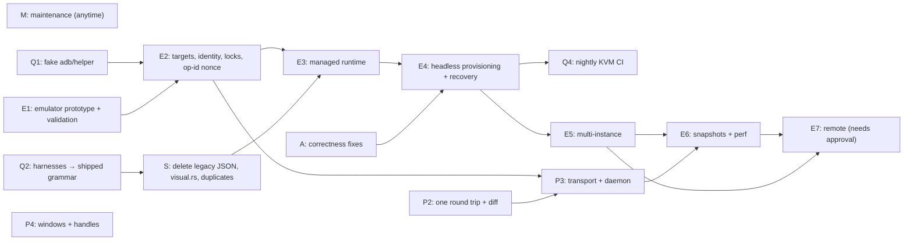

# Android Use master roadmap

Status: **proposed**. It needs the owner's acceptance before any priority below counts as approved.

Baseline: `main` at `5509535` (1.0.0, 2026-08-14). Inventory taken 2026-10-10.

This is the single roadmap for the project. Two design documents feed it:

- [redesign.md](redesign.md): the review-driven redesign proposal (exploratory).
- [android-emulator-integration.md](android-emulator-integration.md): the emulator plan (new).

When either document's sequencing disagrees with this one, **this file wins**. Amend it rather than forking a plan.

## 1. Inventory of existing initiatives

| Initiative | Source | Status |
| --- | --- | --- |
| 1.0.0 product: two-tool MCP, command grammar, helper authentication, Chrome CDP, journal, artifacts, setup/doctor, release pipeline | CHANGELOG 1.0.0, code | **Implemented**. Unit tests, golden vector and fuzz run in CI; live device suites are manual and opt-in |
| Legacy structured JSON protocol, kept "during deprecation" | CHANGELOG 1.0.0, `docs/reference/agent-protocol.md` | **Deprecated, still shipped.** No removal date. The live harnesses (`xtask live/stress-live/benchmark-live`) still depend on it |
| "One device per server process; no fleet scheduler, tenancy layer or remote broker" | `docs/production.md`, CHANGELOG notes | **Standing product decision** |
| Redesign stage 1: correctness fixes (unknown receipt, stop-on-failure, `isError`, substring targeting, truncation, `-32601`, mic capability, real grammar fuzzing, protocol.md regeneration) | redesign.md §5.1 | **Proposed; defects verified in code**; not started |
| Redesign stage 2: one round trip per action plus settle and diff, `structuredContent` | redesign.md §5.2 | **Exploratory** |
| Redesign stage 3: adb smart-socket transport, blob frames, per-target daemon, HMAC authentication | redesign.md §5.3 | **Exploratory** |
| Redesign stage 4: multi-window model, element handles, `scroll until` | redesign.md §5.4 | **Exploratory** |
| Redesign stage 5: single grammar spec, delete legacy JSON, `visual.rs`, duplicates, docs consolidation | redesign.md §5.5 | **Exploratory** |
| Dependency updates | open Dependabot PRs | **Pending.** #20–#37, #43–#44 target live paths. **#10–#18 target `crates/` and `android/aubridge`, both deleted in `a03e1b5`, and are stale** |
| Emulator integration, Phases 0–7 | android-emulator-integration.md | **New** (this task) |

Nothing else was found. The repo has no open issues, no non-Dependabot open PRs, and no other plan files. PRs #19, #39 and #40 are closed, and their content landed directly on `main`. Plans that live outside this repository were not available to this review. Record them here if they exist.

## 2. Tracks

| Track | Scope | Owner doc |
| --- | --- | --- |
| **M**: Maintenance | Dependency PRs; close stale-path PRs #10–#18; docs drift fixes | here |
| **A**: Agent correctness | Redesign stage 1 | redesign.md |
| **Q**: Shared test infrastructure | Q1 fake adb and fake helper harness; Q2 port live harnesses to the shipped grammar; Q3 opt-in emulator E2E; Q4 nightly KVM CI job | both |
| **E**: Emulator | Phases 1–7 | android-emulator-integration.md |
| **S**: Simplify and delete | Redesign stage 5 | redesign.md |
| **P**: Performance and protocol | Redesign stages 2–4 | redesign.md |

## 3. Where the plans overlap, and how each overlap is resolved

| Overlap | Resolution |
| --- | --- |
| Redesign proposes a fake adb plus fake helper, and emulator Phase 2 needs a fake adb for identity tests | **One effort: Q1.** It is built once in `computer/tests/` and used by Tracks A, E and P |
| Redesign proposes a nightly emulator CI job, and emulator Phases 1/4 need E2E | **One effort: Q3 then Q4.** Q4 is enabled only after E4 makes unattended boot reliable |
| Redesign stage 5 deletes legacy JSON, but the live harnesses depend on it | **Sequencing constraint.** Q2 (port the harnesses) must land before the legacy JSON removal in S |
| Redesign stage 3 adds a per-target daemon, and emulator D4 says one `au serve` per target | **Compatible.** The daemon is per target; the Target abstraction from E2 is its key |
| Redesign stage 3 replaces adb subprocess calls on the hot path, and the emulator lifecycle uses adb and emulator subprocesses | **Compatible.** P3 changes the bridge transport only; lifecycle and setup keep subprocesses. P3 starts **after E2**, so it is built on `Target` and not rebased onto it |
| Redesign stage 3 HMAC secret provisioned at setup, and emulator provisioning in `install.rs` | **Coordinate.** Both add steps to `install::setup`; land E2's target-scoped `setup` first, then both extend it |
| Rust budget room is about 880 lines; emulator needs about +840; redesign stage 5 deletes about −650 | **Sequence S's deletions before or alongside E3**, or accept the budget change in §5 |
| Redesign suggests renaming `applicationId` (`dev.codex.aubridge`) | **Conflict.** A rename breaks in-place upgrades, and emulator provisioning bakes in the component name. **Decide before E4.** The recommendation is to keep the id and rename only the user-visible labels |
| Redesign stage 4 multi-window model (helper) | **Independent** of the emulator work; it can run in parallel. Emulators benefit, because system dialogs are common on fresh images |
| Operation-ID reuse across MCP sessions (found during emulator review, `engine.rs:659-667`) | **Fixed in E2**, task J5. It is also a Track A correctness item, so it is tracked once, in E2 |
| Helper foreground-service types on API 34+ (found during emulator review) | **Tracked once in E1**, task J3. It affects phones too |

## 4. Order of work

These can run **in parallel, starting now**:

- M;
- A;
- Q1;
- E1, which needs only a KVM, WHPX or HVF machine;
- Q2;
- P4 (helper only).

These must run **in sequence**:

- E2 → E3 → E4 → E5 → E6 → E7;
- Q2 → S;
- E2 → P3;
- A → E4. Unattended agents must not run on a protocol that reports failures as success.

Recommended priority:

1. **A (correctness) and E2's identity fix (J4, J5).** These fix live risks on phones today.
2. **E1 prototype and Q1.** These cheaply retire the open unknowns U1–U6.
3. **E2 completion, then Q2, then S.** This frees budget and removes the deprecated path.
4. **E3 and E4.** Usable managed emulators.
5. **P2.** The biggest agent-speed win, which benefits both kinds of device.
6. **E5, P3 and P4.**
7. **E6.**
8. **E7**, only after the owner approves §5c.

## 5. Proposed changes to established priorities and policy (need owner sign-off)

| # | Change | Engineering justification |
| --- | --- | --- |
| a | Promote fail-closed device resolution and the operation-ID nonce ahead of all feature work | The current code can bind the wrong device when two transports share a serial (`device.rs:142-148`). It can also replay or reject operations across MCP sessions (`engine.rs:659-667`) |
| b | Set a removal milestone for legacy JSON: after Q2, in the release following emulator Phase 3 | It unblocks deletions (about −650 lines) that pay for emulator code within the existing Rust budget |
| c | Allow a remote broker and hosted workers as Phase 7 | It reverses "no remote broker" (`docs/production.md`). It needs a separate security design first; nothing in Phases 1–6 depends on it |
| d | Only if (b) is declined: raise the Rust production budget from 6,500 to 7,400 lines | Emulator plus targets is about +840 lines. Without deletions this exceeds the room. Tests stay unbudgeted, and the E2E harness lives in tests |
| e | Allow emulator-only Accessibility provisioning through the shell uid (`au emulator start --provision`) | The operator owns the virtual device. The code is hard-gated to AU-created AVDs (android-emulator-integration.md C.8). Phones keep on-device approval |

## 6. Status legend for future updates

When a track item lands, update its row in §1 with the PR number and change its status: Proposed → In progress → Implemented → Verified (where Verified means a test proving it runs in CI or in a recorded opt-in run). Never mark an item Verified on the strength of a document alone.
